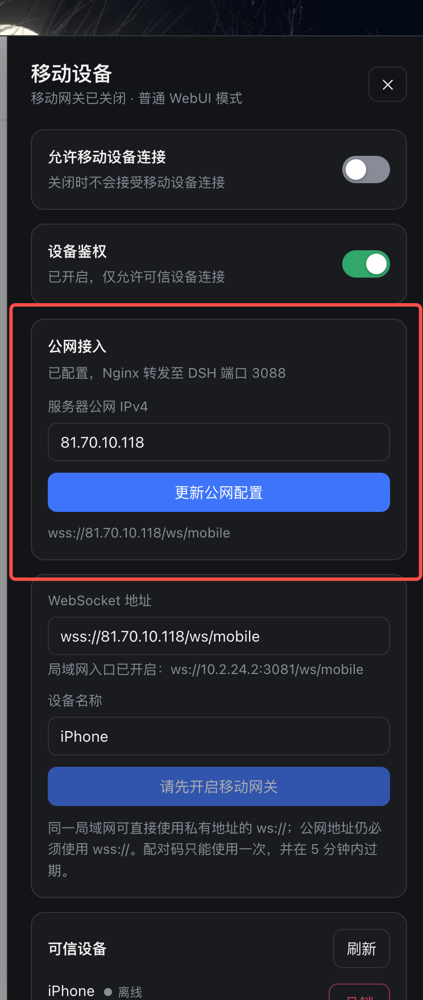

<p align="center">
  
</p>

# 鲸尾移动网关

`dsh-plugin-weapp-gateway` · DeepSeek Harness 移动客户端连接插件

### v0.8.27 · 移动端 App 新协议适配

- 新增 `turn-outline-v1`：会话快照与控制流同步完整轮次大纲，支持客户端按 seq 懒分页定位历史。
- 新增 `agent-team-v1` / `subagent-conversations-v1`：读取编队与子会话投影；子会话的历史、实时订阅、继续对话、中断和独立待办走带父地址的官方 Host 路由。
- 新增 `file-upload-v1`：配对设备通过 control 通道分块上传文件，校验长度与 SHA-256 后进入 DSH 官方附件存储；仅 Host 提供流式上传服务时公布能力。
- 新增 `file-references-v1`：实时/历史消息保留原生文件引用元数据；保留已有工作区文件下载协议，不把附件 ID 当成本机路径。
- Host Adapter 基线更新为 DSH 0.2.1-rc.2 / Session format 4；移动端 `dsh-mobile-v1` 与 `hello.protocol: 3` 不变。客户端需要按能力单独接入 UI，指南见 [轮次导航](docs/turn-outline-app-integration.md)、[编队与子会话](docs/agent-team-app-integration.md)、[文件上传](docs/file-upload-app-integration.md)。

### v0.8.23 · 额度设置读取提速

- 修复小程序额度卡片页偶发「读取失败 / 未连接」：`config` 动作改为**只读缓存**，不再在打开设置页时同步请求官方余额/OpenCode Go；慢速账户接口被 8 秒上限兜底，避免整个配置请求超时。
- 首次打开额度页仍会自动触发一次 `refresh` 拉取实时数据；之后由各来源的刷新间隔控制。
- 小修复复：从设置页返回首页、连接状态变化时，小程序会立即重读网关的侧栏显示开关，不再显示过期卡片。

### v0.8.22 · 额度卡片对齐插件额度页

- 网关内置 `dsh-cost-meter` 插件额度页的额度来源：官方余额、OpenCode Go、15 家 Coding Plan（OpenDesign / Factory / Anthropic / Z.ai / MiniMax / Kimi / OpenRouter / SiliconFlow / CommandCode / Cline Pass / SCNet / 火山方舟 / 千问 / 小米 MiMo / WorkBuddy）、CLIProxyAPI 网关额度与自定义 Provider 余额（最多 8 条）。
- `cost-meter` 新增 `refresh-source`、`source-config`、`set-source-key` / `clear-source-key` 等动作；`update` 支持 `display`（四种左侧栏样式与显示位置）、预算显示、Coding Plan 与网关来源配置。小程序不再需要安装 `dsh-cost-meter`。
- 厂商适配复用 `dsh-cost-meter` 的 MIT 代码（`lib/vendor/cost-meter/`，见 `THIRD-PARTY-NOTICES/dsh-cost-meter.txt`）；SCNet / 千问按本地逐模型会话用量估算，其余厂商走官方额度端点。
- 所有凭据只写入 DSH 凭据库；额度设置写入 `$DSH_HOME/storages/weapp-cost-dashboard.json`（0600）。自定义余额端点只允许 https（本机回环可用 http），拒绝重定向并在外发凭据前校验主机白名单。
- 协议细节见 [PROTOCOL.md](PROTOCOL.md#额度卡片cost-meter-v1)。

### v0.8.21 · 额度卡片原生数据

- `cost-meter` 在原 `summary` / `config` / `update` / `refresh` 基础上直接返回 `dashboard`：官方账号余额、OpenCode Go 滚动/周/月额度、峰谷时段与自定义余额；首页左侧栏额度卡片与「设置 → 侧栏 → 额度卡片」共用这一路数据，不依赖 `dsh-cost-meter` 插件。
- 新增 `set-go-key` / `clear-go-key` / `set-balance-key` / `clear-balance-key`：密钥仅写入 DSH 凭据库，不回传移动端；显示与峰谷设置写入 `$DSH_HOME/storages/weapp-cost-dashboard.json`（权限 0600），余额与 Go 额度各缓存 60 秒，`refresh` 强制刷新。
- `hello.capabilities` 声明 `cost-meter-v1`；协议细节见 [PROTOCOL.md](PROTOCOL.md#额度卡片cost-meter-v1)。

### v0.8.18 · 上下文仪表盘 v2

- `mobileContext` 投影升级到 `stateVersion: 2`（旧缓存自动 refold），新增 additive 字段：
  `activity`（用户输入/读取/写入/搜索/图片）、`timing` 六段拆分（等待/思考/回复/工具参数/工具执行/其他）+ 输出速度、`spans` 时间轴（≤600 段）、`requests[].items/prompt/output`（请求明细，上限 200）、`lastAnswer`（最近回答预览）。
- `context-fleet` 增加 `team`（Host `agentTeam` 投影的成员/任务，各 20 条）与每个 Agent 的 `lastAnswer/phase`；微信小程序上下文/编队 v2 卡片与运行中动态刷新依赖这些字段，旧字段语义不变。
- 协议细节见 PROTOCOL.md「上下文仪表盘与 Agent 编队」。

### v0.8.17 · 修复上下文仪表盘读取

- 修复 `context-dashboard`：Host adapter 的 `sessions.history` 返回原始 `session/follow` 快照（没有 `kind` 字段），旧实现误判为读取失败并返回 `context-unavailable`；现在同时接受快照形状与网关 `proxyQuery` 的 `kind: 'history'` 形状，并补充回归测试。
- `mobileContext` / `context-fleet` 数据与协议不变，无需客户端或配对变更。

### v0.8.16 · 上下文仪表盘与 Agent 编队

- 新增纯函数会话投影 `mobileContext`：把会话事件流折叠为上下文构成（system / tools / user / inject / skill / assistant / tool）、累积 token、请求趋势、工具调用、压缩/剪枝事件与真实工作时长（剔除提问与审批等待）。token 估算与 DSH token meter 的固定密度启发式一致，折叠状态有界并可被投影缓存检查点。
- 配对设备可通过 `context-dashboard` 读取当前会话的仪表盘数据，并附带 Host 的 `contextBreakdown` / `tokenUsage` / `sessionStats` 官方投影；Host 未注册投影时返回 `context-unavailable`。
- `context-fleet` 返回当前 Agent 的会话家族（祖先链 + subagent 子树，最多 40 个成员），每个成员带上下文构成、token、轮次/步骤、运行状态与耗时；fork 不作为 subagent 子节点，只在祖先链中显示。
- `hello.capabilities` 新增 `context-dashboard-v1` 与 `context-fleet-v1`；请求必须来自已配对设备，旧 Host 或未提供服务的 Host 返回 `context-unavailable`，网关其余功能不受影响。
- 协议细节见 [PROTOCOL.md](PROTOCOL.md#上下文仪表盘与-agent-编队context-dashboard-v1--context-fleet-v1)。

### v0.8.15 · 工作区附件与 DeepSeek 账号

- 移动端发送消息时可附带工作区文件或目录引用：最多 6 项、只接受工作区相对路径，网关拒绝绝对路径、`..` 和空项；引用会作为受校验的上下文发送给 Agent，并不伪造文件 receipt。
- 实时与历史 `user/message`、`assistant/message` 事件新增 `attachments` 元数据；历史消息中的 `[工作区文件: …]` / `[工作区目录: …]` 文本也会被解析为同结构，客户端不必自行解析正文。
- 配对设备可通过 `account-v1` 能力读取当前 DeepSeek 账号的登录状态、资料与余额；Host 未提供账号服务时能力不出现，请求返回 `account-unavailable`，旧 Host 自动降级。
- 协议细节见 [PROTOCOL.md](PROTOCOL.md#deepseek-账号account-v1)。

### v0.8.13 · 网关内置微信 ClawBot

- 将 ClawBot 控制、iLink 收发和目标会话接入直接放进网关；不再调用 `dsh-wechat-remote` 的控制 RPC，也不要求安装该插件。
- 小程序「设置 → 实验性功能」管理微信绑定、接入会话和启停。微信凭据及消息收件状态留在电脑本地，移动端只通过配对网关发出控制请求。
- 复用本机已有 ClawBot 状态目录并加单实例锁；若旧服务仍占用状态，先停止旧的私聊接线服务并重启 DSH，再由网关接管，避免同一账号被两个轮询器同时处理。
- 新增 `wechat-clawbot-control-v2` 能力标记；升级网关后重新连接小程序。

### v0.8.12 · 显示插件升级失败详情

- 安装器返回结构化错误时提取可读信息，不再显示 `[object Object]`；错误序列化会省略凭据、令牌和堆栈字段。

### v0.8.11 · 小程序 ClawBot 私聊接线控制（旧版代理，已由 v0.8.13 取代）

- 在已配对的小程序控制通道中增加受限的 ClawBot 控制 RPC，复用 `dsh-wechat-remote` 自身的访问授权、状态冲突检查和本地凭据存储。
- 支持读取状态、绑定流程、选择普通 DSH 会话、启停与移除本地绑定；微信凭据不传回小程序。
- 新增 `wechat-clawbot-control-v1` 能力标记，客户端可对旧版网关明确降级。

### v0.8.9 · 插件在线更新

- 打开「设置 → 鲸尾移动网关」时自动检查 npm 最新版本，并可在面板中一键安装更新。
- DSH 宿主支持插件管理时直接升级；旧版宿主会给出 Terminal 安装命令。构建脚本审批不会自动批准，要求重启时需手动重启 DSH。
- 接入小程序订阅通知：通过一次性通知票据，在对应会话轮次结束后回调通知服务，不发送任务正文。

### v0.8.8 · 实时文件事件同步

- 补齐实时事件中的 `workspace/changes` 与 `deliverables/presented` 转换，使实时帧与持久历史使用相同的会话、轮次和文件声明结构。
- 修复小程序已连接时无法实时收到文件变更摘要和交付文件声明的问题。
- 升级无需重新配对或迁移数据；更新插件后重新加载插件或重启 DSH 即可。

协议与客户端处理约定见 [文件变更接入说明](docs/workspace-changes-mobile-integration.md)。

DeepSeek Harness 的设备鉴权移动连接插件，支持会话与实时事件、排队消息同步及编辑/删除/Steer、Session 归档和重命名的双向同步、停止当前生成并稍后继续、任务列表和当前 Goal 同步及管理、服务端驱动的命令和技能菜单、Human-in-the-loop、图片及文件传输。本 fork 不占用侧边栏：全部管理能力集中在 Harness WebUI 的「设置 → 鲸尾移动网关」页面，可直接开启连接服务、生成配对二维码和管理可信设备；离开该页面即停止轮询，不再有任何悬浮层。

> 当前源码以 **DSH 0.2.0-rc.2** 为适配基线，使用 Session format 4；旧版历史游标需重新取得基线。
>
> 实时流已改为独立 `assistant-stream` 帧，移动端需要按 [rc.2 接入说明](docs/dsh-rc2-mobile-integration.md) 更新订阅、缓存与分页处理。当前修改尚未发布。
>
> v0.7.7：同步上游 v0.8.0（DSH 0.1.7-rc.2 / Session format 4、inbox 排队消息同步、Schedule 与 Permission Presets、审批 `displayReason`），管理界面仅保留在「设置 → 鲸尾移动网关」，不再提供侧边栏入口。
>
> v0.8.6（续）：修复 DSH 0.2.1 宿主上所有 Remote 请求崩溃——`Cannot read properties of undefined (reading 'signal')`。0.2.1-alpha 起 `InvokeRemoteRequest.peer` 改为必填（`assertPeerLive` 与 `methodSignal` 都会读 `peer.signal`，流式方法还会并入它），而适配器此前只传 `{namespace, method, args, signal}`；工作区/会话/历史全部不可用，只剩 `default-model`（不走 Remote Gateway）正常。现在适配器以自己的 owner Peer 发言（随插件 dispose 中止），0.1.7/0.2.0 宿主忽略该字段，因此新旧宿主通吃。附 0.2.1 宿主形状的回归测试。
>
> v0.8.6：同步上游 v0.10.1——新增官方语音输入接入（`speech-input-v1`）：移动端可查询识别器、订阅模型准备进度、准备模型、设置识别偏好、提交录音取文字、取消转写，连接关闭时自动清理任务。识别走 DSH 0.2.0-rc.2 官方 speech Remote（本机 runtime 0.2.1-alpha.2 已自带 `dsh-experimental-voice-input-bundle` 与 SenseVoice 模型目录），网关不打包 ASR 模型；面板样式表改由插件 effect 一次性注入 document.head。注意：手机端录音按钮、权限申请与音频转换仍须客户端接入，服务端到此为止。
>
> v0.7.15：按上游 v0.10.0 重新设计面板
>
> v0.7.16：连接与配对页重组
>
> v0.7.17：修正中继未注册提示
>
> v0.7.18：连接与配对页大幅简化
>
> v0.7.19：内置连接器自动安装
>
> v0.7.20：修复两个真实故障
>
> v0.7.21：按上游重做管理界面
>
> v0.8.0：管理界面以上游 v0.10.0 的 client.js 为基底重写（弹窗外壳、左导航、GatewaySelect、帮助气泡、动画、手机端导航置顶全部为上游原样），fork 只保留四项增量：① 入口改为 settings.section（点击设置项直接开弹窗，无侧边栏按钮、无中间卡片）；② 中继 · 小程序进入「配对连接方式」下拉，选中即切换服务端配对模式；③ apiPath 网关前缀修复；④ 设置项导航图标自绘、Cloudflare 手动安装说明与控制台跳转链接。
>
> v0.8.1：修正模块 ID
>
> v0.8.2：移动端三个修复
>
> v0.8.3：修复上一版把弹窗导航按钮点失效的问题
>
> v0.8.4：修复中继模式下打开面板地址栏仍显示 Cloudflare 地址
>
> v0.8.5：扫码成功后二维码弹窗自动关闭——服务端暴露待用配对码 ID，面板轮询发现自己的码被消费即关闭，不用等 5 分钟过期或手动关。——refresh() 原先只看本地路由 ref（初始 auto），现在先采纳服务端的 pairingMode 再推导地址，打开即显示中继地址。——原先用在捕获阶段 stopPropagation 阻止设置页插件折叠导航，但 React 的 onClick 委托在 document 根，捕获阶段拦截会连自己的 handler 一起掐死。改为 MutationObserver 监听并即时还原折叠，不碰事件。——弹窗导航按钮固定 40px 高度（不再塌成文字高度）；点导航不再被设置页插件折叠成汉堡按钮（捕获阶段拦截 + 自我恢复）；中继设备自动命名（连接器每次连接都上报手机型号 header，网关据此更新设备名）。——换用上游 client.js 时把 id: 'dsh-plugin-mobile-gateway' 一并带入，加载器按包名找不到注册项，整个插件条目被剔除（设置页消失）。现改回 dsh-plugin-weapp-gateway 并加防回归守卫。
> v0.7.8：同步上游 v0.8.1（PC 端可开启 Cloudflare Quick / 命名 Tunnel、配对面板增加局域网与外网入口选择指引、工具菜单可重启网关或停止 DSH Web），管理界面仅保留在「设置 → 鲸尾移动网关」。
>
> v0.7.9：Cloudflare Tunnel 扩展到 Linux 服务器（本 fork 定制）：上游仅支持 Windows/macOS 自动下载校验 `cloudflared`，本 fork 允许在 Linux 上使用 Cloudflare 官方 apt 源安装的 `cloudflared`（或配置 `cloudflaredPath` 指向任意可执行文件），隧道机制不变。
>
> v0.7.10：下拉选择框改为主题感知的自绘箭头
>
> v0.7.11：下拉改为完全自绘的列表框
>
> v0.7.12：命名 Tunnel 的表单里内置
>
> v0.7.13：跳转链接改为主题链接蓝（`--dsw-alias-link`，不加下划线，hover 仅轻微变淡），与 DSH 自身的链接样式一致。「Cloudflare 控制台 → 隧道」与「官方创建教程」两个跳转链接，并说明 Token（安装命令里 eyJ… 那段）与 Service URL 的获取位置；README 同步改写为五步流程。（触发器 + 弹出面板 + 键盘导航，支持 Escape / 点击外部关闭），展开样式跟随宿主明暗主题；「配对连接方式」与「Cloudflare 接入方式」两个下拉均换用该组件。（appearance 重置 + hover/禁用态 + 跟随明暗的 chevron），不再用浏览器原生样式；「配对连接方式」在 Cloudflare Tunnel 受支持时始终列出该项（未开启时标注「未开启」并引导先去开启），修复关着隧道时该选项直接消失、看起来像没接入的问题。
> v0.7.3：优化移动网关运行模式下拉框的箭头间距。
>
> v0.7.2：新增独立对话/控制连接、空 Session 创建、停止生成与稍后继续、排队消息同步及编辑/删除/Steer，以及 Session 归档和重命名的双向同步。

## 协议与 DSH 兼容层

移动端连接的是本项目维护的 `dsh-mobile-v1`，不是 DSH 的内部 Remote 协议。当前 Host Adapter 基线为 DSH 0.2.1-rc.2 / Session format 4；Session、Workspace、Settings、Commands、Goals、Schedule、Permission Presets 与新增上传/子会话路由的 Remote 参数只存在于适配层。旧 Host 不满足本版硬依赖时不能加载此版插件；移动端新增功能仍需按 `hello.capabilities` 判定是否启用。Plugin Manager 系列请求帧经配对设备连接管理插件目录、安装、启停、设置与版本豁免，方案见 [DSH 0.2.0 插件管理对接方案](docs/dsh-0.2.0-rc.2-plugin-management-mobile-integration.md)。

配对鉴权和 `dsh-mobile-v1` / `hello.protocol = 3` 保持不变。新版实时 token 不占用持久事件的 `seq`：客户端显式订阅 `assistantStream: true`，接收原子的 `session-snapshot` 和独立增量；普通 `event` 只携带持久事件。未接入新订阅的客户端只能收到持久消息。

历史响应包含 `historyFormatVersion` 和 `cursor`。客户端格式变化时应清理历史缓存、重新安装基线；携带 `beforeSeq` 的分页或携带 `atSeq` 的 fork 必须同时发送 `historyFormatVersion: 4`。
当前协议接入与验收见 [rc.2 移动端接入说明](docs/dsh-rc2-mobile-integration.md)；早期迁移记录见 [Remote Gateway 重构实施计划](docs/remote-gateway-refactor-plan.md)。

- WebSocket：`/ws/mobile`
- 局域网：`ws://<局域网 IP>:3081/ws/mobile`
- Linux 服务器公网：`wss://<公网 IP>/ws/mobile`
- 协议文档：[PROTOCOL.md](PROTOCOL.md)

当前源码新增会话模式选择：App 创建空白 Session 后，可查询并修改该 Session 的 Agent preset；首次对话后锁定。通过 `session-agent-preset` 能力发现接入，详见 [App 接入说明](docs/session-agent-preset-app-integration.md)。App 界面需按此说明接入，本次源码尚未发布。

## 多网关第一阶段（当前源码）

插件提供稳定 `gatewayId`、可配置 `gatewayName`、配对候选地址列表，以及可持久化的“关闭 / 临时开启 / 常驻开启”运行模式。一个 App 可以分别配对不同机器上的网关；客户端多网关管理仍需按 [App 对接说明](docs/multi-gateway-app-integration.md) 实现。本次源码尚未发布新的 npm 版本。

在“鲸尾移动网关”面板选择“常驻开启”，网关会持续接受已授权设备连接，重启后保持。常驻需要 DSH 进程运行、机器未休眠且网络可达，不提供自动发现或网络中转。

部署配置示例（对应 mobile-gateway 插件的 `config`）：

```yaml
gatewayMode: persistent
gatewayName: 家里电脑
requireAuth: true
endpoints:
  - wss://gateway.example.com/ws/mobile
  - ws://192.168.1.10:3081/ws/mobile
notificationServiceUrl: https://dsh.ahwe.top
```

小程序的「订阅通知」偏好开启后，网关会在对应的 `turn/end` 回调已授权的一次性通知票据，并附上可用的会话标题、回合耗时、Token 用量和缓存命中率。Token 用量来自本回合 Assistant usage 的输入与输出总量；缓存命中率使用 `cacheReadTokens / (uncachedInputTokens + cacheReadTokens)`，缺少未缓存输入时回退到 `inputTokens`。通知不包含任务正文或模型回复。若希望 Token 显示为 `12.3K`，微信模板对应字段须为 `character_string`；`number` 类型只能显示纯数字。自托管公网服务时，将 `notificationServiceUrl` 改为小程序 `access-config.js` 中相同的 HTTPS 服务根地址。

运行模式的优先级：**已保存的界面选择 > `gatewayMode` > 旧 `gatewayEnabled`**。没有保存选择时，旧配置 `gatewayEnabled: true` 对应常驻，false 对应关闭。

- 关闭：立即断开移动连接，重启后仍关闭。
- 临时开启：默认 5 分钟没有设备成功连接则关闭并保存关闭状态；成功连接后本次运行保持开启。若以临时模式重启，则重新开始等待首次连接。`gatewayWaitTimeoutMs` 可配置 30 秒至 30 分钟。
- 常驻开启：没有无人连接关闭计时器。配对码仍默认 5 分钟过期，文件传输超时等独立规则不变。

状态默认保存到 `<deviceFile>.gateway.json`，通常为 `~/.dsh/mobile-gateway-devices.json.gateway.json`；可通过 `gatewayStateFile` 单独配置。文件包含随机 UUID v4 身份及用户选择，权限为 `0600`，使用同目录临时文件原子替换；损坏时启动报错，不能静默生成新身份。每个运行实例必须使用独立的设备注册文件和状态文件。

升级和迁移机器时应一并保留这两个文件。克隆为新的独立网关时，不复制原实例的状态文件和设备注册文件，让新实例生成新身份并重新配对。不要在运行中删除身份文件来恢复默认模式；如需重新使用启动配置，应停止该实例、备份状态文件、仅将其 `mode` 改为 `null`，保留 `version` 和 `gatewayId` 后重启。

`gatewayName` 最多 80 字符，未设置时使用主机名。`endpoints` 是额外候选地址，最多 16 项，每项最多 2048 字符；配对时还会合并首选地址、公网配置与已监听的 LAN 地址，合并超过 16 项会报错。所有地址必须指向同一网关；不得填写 `0.0.0.0` / `::`。地址需要手机实际可达，公网使用 WSS。

测试结果与人工步骤见 [验收报告](docs/multi-gateway-phase1-acceptance.md)，完成范围见 [多网关待办](docs/multi-gateway-todo.md)。

## 配套 iOS 客户端

[DeepSeek Harness Mobile](https://github.com/Clarklevis1995/dsh-mobile) 是本仓库的兄弟项目。它是面向 iOS 17+ 的 SwiftUI 原生客户端，支持工作区与会话、工作区内创建文件夹、历史和实时对话、图片、Agent 执行轨迹、Human-in-the-loop，以及由网关配置驱动的命令、技能、模型与权限菜单。

<table>
  <tr>
    <td width="33.33%" align="center"></td>
    <td width="33.33%" align="center"></td>
    <td width="33.33%" align="center"></td>
  </tr>
  <tr>
    <td align="center"><strong>工作区首页</strong></td>
    <td align="center"><strong>实时对话</strong></td>
    <td align="center"><strong>设备配对</strong></td>
  </tr>
</table>

## 安装插件

前提：已经安装 `dsh` CLI 和 `pnpm`，并能正常启动 `dsh web`。可先执行 `pnpm --version` 确认当前用户的环境能够找到 `pnpm`。

局域网使用只需安装插件：

```bash
dsh plugin --profile web add dsh-plugin-weapp-gateway@latest
```

需要在 Linux 服务器通过公网 IP 接入时，推荐执行统一初始化命令。它会安装/更新插件，并请求一次 sudo 权限安装系统 Helper：

```bash
npx --yes dsh-plugin-weapp-gateway@latest init
```

`init` 会把当前正在执行的 npm 包精确版本安装到 DSH profile，并仅对该版本跳过 pnpm 的新版本等待期，确保插件与 Helper 版本一致。

安装后停止并重新启动 WebUI：

```bash
dsh web
```

打开 WebUI，进入「设置」确认出现「鲸尾移动网关」页面（侧边栏不会新增入口）。

## 局域网配对

适用于 DSH 电脑与 DSH App 或鲸尾小程序位于同一个可互访的局域网。

1. 在 WebUI 的「设置」中打开“鲸尾移动网关”。
2. 将“网关运行模式”设为“常驻开启”（短期配对也可选“临时开启”）。
3. 保持“设备鉴权”开启。
4. 在“配对连接方式”选择“局域网直连”，确认 WebSocket 地址为 `ws://<电脑局域网 IP>:3081/ws/mobile`。即使 Cloudflare Tunnel 已开启，也无需关闭它。选择框旁的问号会按当前网关环境解释各入口并给出场景建议，不会自动更改选择。
5. 填写设备名称并点击“生成配对二维码”。
6. 在 DSH App 或鲸尾小程序扫描二维码。
7. WebUI 的可信设备显示“在线”后即完成。

如果系统防火墙拦截连接，只允许私有网络访问 TCP `3081`。不要把 3081 开放到公网。

## Linux 服务器公网 IP 配对

> [!NOTE]
> 本文所说的“公网 IP 配对”特指 Linux 服务器。一键公网安装从 `v0.6.4` 开始提供，适用于带固定公网 IPv4 的 Ubuntu/Debian 服务器。服务器需要已经安装 Node.js、`pnpm` 和 `dsh` CLI；当前尚不支持 CentOS。

### 1. 准备公网端口

在云厂商控制台复制服务器的公网 IPv4，并在安全组中放行入站 TCP `80` 和 `443`。不要将 DSH WebUI 端口或 TCP `3081` 开放到公网。

### 2. 一键初始化

先确认普通 DSH 用户可以直接调用 `pnpm`：

```bash
pnpm --version
```

然后使用同一个普通用户执行（不要使用 `root` 或 `sudo npx`）：

```bash
npm_config_registry=https://registry.npmjs.org \
npx --yes dsh-plugin-weapp-gateway@latest init
```

该命令会安装或更新插件，并请求一次 sudo 权限安装 Nginx、Certbot、系统 Helper 和证书续期定时器。`init` 会确保 DSH profile 与 Helper 使用同一个精确版本。

完成后启动或重新启动 WebUI：

```bash
dsh web
```

### 3. 打开远程 WebUI

优先使用 VS Code、Cursor 等 IDE 自带的端口转发。也可以在自己的电脑执行：

```bash
ssh -N -L <本地端口>:127.0.0.1:<DSH 实际端口> <服务器用户名>@<服务器公网 IP>
```

然后在本地浏览器打开：

```text
http://127.0.0.1:<本地端口>
```

### 4. 在 UI 配置公网入口

在 WebUI「设置 → 鲸尾移动网关」中打开面板，在“公网接入”填写云厂商控制台提供的公网 IPv4，然后点击“配置公网接入”或“更新公网配置”。Helper 会自动读取当前 `dsh web` 端口并配置 Nginx、TLS 证书和 `wss://<公网 IP>/ws/mobile`。

<p align="center">
  
</p>

### 5. 配对移动设备

1. 开启“允许移动设备连接”，保持“设备鉴权”开启。
2. 填写设备名称并点击“生成配对二维码”。
3. DSH App 或鲸尾小程序扫描二维码后，会按候选地址尝试公网 WSS 与局域网连接；局域网地址仍可在同网或 VPN 时使用。
4. WebUI 的可信设备显示“在线”后即完成。

二维码只能使用一次，并会在 5 分钟后过期；超时后在 WebUI 重新生成即可。
“自动选择”会把可用公网 WSS 和局域网地址放入直连候选列表；公网 WSS 就绪时 DSH App 与小程序都能尝试这两类地址。没有公网入口时，App 使用局域网；小程序优先使用已注册的鲸尾中继，否则使用局域网。
原有“鲸尾公网 · 小程序”专用中继配对选项也保留：需要强制使用鲸尾中继、且二维码只给小程序使用时选择它；想用同一张码配对 App 和小程序时选择自动模式。

## Windows / macOS 家用电脑远程连接

家用电脑通常没有固定公网 IP，不建议配置路由器端口转发。Windows / macOS 面板提供两种可选入口：无需账户或域名的 Quick Tunnel，以及使用固定域名的命名 Tunnel。插件会在首次开启时自动下载并校验 Cloudflare 官方 `cloudflared`，保存在当前用户的缓存目录；无需手动安装系统服务。

使用前先启动 `dsh web`。电脑必须保持开机、联网且 DSH 进程运行；休眠或进程退出后外网连接会中断。

### Cloudflare Quick Tunnel（一键临时接入）

在「鲸尾移动网关 → 连接与配对」展开 Cloudflare 外网设置，选择「Quick Tunnel · 无需域名」并点击「一键开启」。面板连接后会取得随机的 `wss://<名称>.trycloudflare.com/ws/mobile`。生成“自动选择”二维码后，DSH App 和小程序都会获得公网 WSS 与局域网候选地址，并自动尝试可达线路。原有“鲸尾公网 · 小程序”专用中继选项仍可单独使用。关闭开关会停止隧道；DSH 再次启动时会恢复已开启的 Quick 模式并取得**新的随机地址**。

Quick Tunnel 无需 Cloudflare 账户、Token 或自己的公网域名，但地址在 DSH 重启或隧道重连后可能变化。若隧道地址变化，重新生成二维码供 DSH App 或小程序配对；**仅凭 PC 在线不能保证旧地址继续可用**。Cloudflare 将 Quick Tunnel 定位于测试和开发，当前有并发请求上限且不提供可用性保证。参见 [Cloudflare Quick Tunnel 文档](https://developers.cloudflare.com/cloudflare-one/networks/connectors/cloudflare-tunnel/do-more-with-tunnels/trycloudflare/)。

面板中的“更新 Tunnel 配置”保存所选模式及命名 Tunnel 参数；配置不变时不会重新连接。“重启 Tunnel”会断开当前移动连接并重建 Cloudflare 隧道，不会重启 DSH Web；Quick Tunnel 重启后可能取得新地址，旧二维码会清除，需按新地址重新扫码。此操作不会自动升级 `cloudflared` 到最新版本。

### Cloudflare 命名 Tunnel（固定地址）

面板（「鲸尾移动网关 → Cloudflare Tunnel」选「命名 Tunnel」）里内置了两个跳转链接：
[Cloudflare 控制台 → 隧道](https://dash.cloudflare.com/?to=/:account/tunnels) 和
[官方创建教程](https://developers.cloudflare.com/cloudflare-one/networks/connectors/cloudflare-tunnel/get-started/create-remote-tunnel/)。

1. 打开控制台 → **Networking > Tunnels** → **Create a tunnel** → 选 `Cloudflared` → 填一个 Tunnel 名字（如 `dsh-nas`）。
2. 控制台随后给出安装命令（`cloudflared service install <Token>` 的形式）。**Token 就是这条命令里 `eyJ…` 开头的那一段**——插件会用自己的 cloudflared 运行，你不需要在 NAS 上执行这条命令，只需复制 Token。
3. 在 Tunnel 的 **Routes / Public Hostname** 里添加一条路由：子域名 + 域名（例如 `gw.example.com`，域名需托管在 Cloudflare），**Service URL 设为 `http://127.0.0.1:3082`**（与面板里显示的本机端口一致；自定义 `cloudflarePort` 时同步修改）。
4. 回到面板填入公开域名和 Token，点「开启命名 Tunnel」。插件会将网关设为常驻模式，启动本机专用入口和 `cloudflared`。面板确认公网入口可达后，生成“自动选择”二维码；DSH App 和小程序都可使用公网 WSS，并保留局域网候选地址。
5. 以后启动 `dsh web` 会自动恢复已开启的 Tunnel；在面板点击「关闭 Cloudflare Tunnel」会停止插件管理的 `cloudflared` 并关闭本机专用入口。若手动关闭网关，Tunnel 会暂停，重新开启网关后恢复。

两种 Cloudflare 入口都只接受 `/ws/mobile` WebSocket，其他 HTTP 路径（包括 DSH WebUI 和 `/mgw` 管理接口）返回 404；设备凭证始终必需，即使本机 Debug 鉴权被关闭也一样。命名 Tunnel 的 Token 保存在 `<deviceFile>.cloudflare.json`（默认 `~/.dsh/mobile-gateway-devices.json.cloudflare.json`），权限为 `0600`，不会返回给浏览器。默认使用 DSH 私有的 `cloudflared-bin` 缓存，不读取系统或其他 App 的 `cloudflared`；每次启动 Tunnel 都校验缓存文件，只有缓存缺失或损坏时才下载固定版本并核对 Cloudflare 官方发布资产的 SHA-256。仅在显式配置 `cloudflaredPath` 时使用外部程序。使用自定义 `cloudflarePort` 时，命名 Tunnel 路由的 Service URL 端口也要相应修改。

### Linux 服务器（本 fork 定制）

上游把 Cloudflare Tunnel 限定在 Windows / macOS：自动下载只覆盖这两个平台的发布资产。本 fork 放开了 Linux：Cloudflare 官方为 Debian/Ubuntu 提供 GPG 签名的 `cloudflared` 包（[pkg.cloudflare.com](https://pkg.cloudflare.com/)），由系统包管理器负责来源可信，插件直接使用已安装的程序，不再自行下载。

安装（Debian / Ubuntu 源，以 root 执行一次）：

```bash
mkdir -p --mode=0755 /usr/share/keyrings
curl -fsSL https://pkg.cloudflare.com/cloudflare-main.gpg -o /usr/share/keyrings/cloudflare-main.gpg
echo 'deb [signed-by=/usr/share/keyrings/cloudflare-main.gpg] https://pkg.cloudflare.com/cloudflared any main' \
  > /etc/apt/sources.list.d/cloudflared.list
apt-get update && apt-get install -y cloudflared
```

安装后「鲸尾移动网关 → Cloudflare Tunnel」分组即出现在面板（与 Windows/macOS 相同）。插件按以下顺序定位程序：profile 配置里的 `cloudflaredPath`（绝对路径优先），否则在 PATH 中查找 `cloudflared`；都不存在时面板会提示上面的安装命令。其余行为（Quick / 命名模式、配对地址自动填入、Token 保存、`/ws/mobile` 之外一律 404）与 PC 完全一致；Linux 同样不会监听 DSH WebUI 或 `/mgw` 的对外路径。

#### 公网入口检测与状态含义

`state: online` 只表示 cloudflared 已注册隧道连接，不保证公开域名、TLS 或源站路由可用。状态 API 另外提供 `endpointHealth`（状态、提示、检测时间及错误码）和 `publicReady`。面板在连接后自动检测一次，也可点击「检测公网 DNS / TLS / WebSocket」重试；该按钮调用受现有管理鉴权保护的 `POST /mgw/cloudflare/check`，不会重启隧道。

检测使用本机系统 DNS 和严格证书校验的 HTTPS WebSocket 请求，不携带配对码或设备 Token，不跟随重定向。只有 HTTP 401 且移动网关回显本次随机探测标记时，才确认受鉴权保护的网关路由可达；代理或 Cloudflare Access 的普通 401 不会被当作成功。该标记只在缺少有效设备凭证的拒绝响应中回显，不授予任何访问权限。结果是一次本机网络快照，不保证手机网络、设备鉴权或会话同步成功。

本机解析失败不代表公共 DNS 记录必然不存在：刚创建记录时可能仍有 NXDOMAIN 缓存，也可能受本机 DNS、VPN 或代理影响。核对公开主机名和已代理 CNAME，再稍后重试，不要关闭 TLS 校验。插件目前使用 Tunnel Token 运行远程管理的隧道，该 Token 不会自动创建域名路由或 DNS；具备额外账户授权的 cloudflared CLI / Cloudflare API 可以配置这些资源，但不属于本检测功能。

### Tailscale（推荐长期使用）

1. 在电脑和 iPhone 安装 [Tailscale](https://tailscale.com/download)，并登录同一个 Tailnet。
2. 在 Windows PowerShell 或 macOS 终端执行：

```bash
tailscale serve --bg 3081
```

3. 执行 `tailscale serve status` 查看生成的 `https://<设备名>.<tailnet>.ts.net` 地址。
4. 将地址改为 `wss://<设备名>.<tailnet>.ts.net/ws/mobile`，填入 WebUI 的“WebSocket 地址”，再生成二维码配对。

Tailscale Serve 只允许同一 Tailnet 中符合访问规则的设备连接，并自动提供 HTTPS。可用 `tailscale serve reset` 停止转发。参见 [Tailscale Serve 文档](https://tailscale.com/docs/reference/tailscale-cli/serve)。

## 网关配置方式总览

| 使用场景 | 推荐入口 | iOS WebSocket 地址 | 需要的额外配置 | 端口与鉴权 |
|---|---|---|---|---|
| 同一局域网 | 插件局域网入口 | `ws://<电脑局域网 IP>:3081/ws/mobile` | 无需 Helper 或 Nginx；电脑与 iPhone 位于可互访的局域网 | 仅对私有网络放行 TCP `3081`；保持鉴权开启 |
| 本机 iOS 模拟器 | DSH WebUI 本地入口 | `ws://127.0.0.1:<DSH WebUI 端口>/ws/mobile` | 无需 Helper、Nginx 或独立的 `3081` 端口 | 不开放任何外部端口；仅 Debug 时可关闭鉴权 |
| Linux 公网服务器 | 插件 Helper + Nginx + TLS | `wss://<服务器公网 IPv4>/ws/mobile` | 执行 `init`，再从 WebUI 填写公网 IPv4 | 云安全组放行 TCP `80/443`；不要公开 DSH 端口和 `3081`；必须鉴权 |
| 家用 Windows / macOS | Cloudflare 命名 Tunnel | `wss://<公开域名>/ws/mobile` | 在 Cloudflare 建立公开域名到 `127.0.0.1:3082` 的路由；面板填写域名与 Token 并开启 | 无需路由器端口转发；独立入口强制设备鉴权 |
| Linux 服务器（本 fork） | Cloudflare 命名 / Quick Tunnel | `wss://<公开域名或随机域>/ws/mobile` | apt 源安装 `cloudflared`（见上文），面板操作与 PC 相同 | 无需路由器端口转发；独立入口强制设备鉴权 |
| 家用 Windows / macOS | Cloudflare Quick Tunnel | `wss://<随机名称>.trycloudflare.com/ws/mobile` | 面板一键开启；重启或重连后地址变化需重新扫码 | 无需域名、账户或端口转发；独立入口强制设备鉴权 |
| 家用 Windows / macOS | Tailscale Serve | `wss://<Tailscale 域名>/ws/mobile` | 手动转发到 `127.0.0.1:3081`，将生成的地址填入 WebUI | 无需路由器端口转发；保持鉴权开启 |

## Linux 服务器公网入口管理

查看状态：

```bash
sudo env "PATH=$PATH" npx --yes dsh-plugin-weapp-gateway@latest status
```

移除公网入口：

```bash
sudo env "PATH=$PATH" npx --yes dsh-plugin-weapp-gateway@latest remove
```

## 更新插件

重新运行初始化命令会同时更新插件和系统 Helper：

```bash
npx --yes dsh-plugin-weapp-gateway@latest init
```

随后停止并重新启动 `dsh web`。

## 卸载插件

```bash
dsh plugin --profile web remove dsh-plugin-weapp-gateway
```

如需同时移除系统 Helper（不会删除现有 Nginx 公网配置）：

```bash
sudo env "PATH=$PATH" npx --yes dsh-plugin-weapp-gateway@latest remove-helper
```

## 常见问题

| 现象 | 处理方式 |
|---|---|
| 「设置」里没有“鲸尾移动网关” | 确认安装在 `web` profile，并完整重启 `dsh web` |
| iOS 收到 `503` | 回到 WebUI 开启“允许移动设备连接” |
| iOS 收到 `401` | 在 WebUI 重新生成二维码并配对 |
| Linux 服务器公网连接超时 | 检查云安全组、服务器防火墙和 TCP `80/443` |
| Linux 服务器公网地址没有显示 | 在“鲸尾移动网关 → 公网接入”填写公网 IPv4 并点击更新 |
| Cloudflare 下载失败 | 检查 PC 到 GitHub Releases 的连接；也可自行安装 cloudflared，并把 `cloudflaredPath` 设为可执行文件的绝对路径 |
| Quick Tunnel 重启后 App 无法连接 | Quick 地址可能已变化，在面板重新生成二维码并让 App 扫码更新配对；需要固定地址时改用命名 Tunnel |
| 面板提示未找到 cloudflared（Linux） | 按上文 apt 命令安装 Cloudflare 官方 `cloudflared`，或把 `cloudflaredPath` 指向已有可执行文件后重启 |
| Quick Tunnel 未能启动且 PC 已有 Cloudflare 配置 | Cloudflare 当前不支持 Quick Tunnel 与 `~/.cloudflared/config.yaml` 共用该配置目录；检查面板错误并按 [官方说明](https://developers.cloudflare.com/cloudflare-one/networks/connectors/cloudflare-tunnel/do-more-with-tunnels/trycloudflare/) 处理 |
| Cloudflare 已连接但 App 无法访问 | 确认公开域名路由的 Service URL 是面板显示的 `http://127.0.0.1:<端口>`，并检查 DNS 与设备配对凭证 |
| 需要查看服务端日志 | 执行 `tail -f /tmp/mobile-gateway.log` |

## 源码开发

```bash
dsh plugin --profile web add file:/absolute/path/to/dsh-plugin-weapp-gateway
npm test
```

面板右上角“工具”菜单提供“重启当前网关”和“停止 DSH Web”。重启只在通过 `dsh web` 启动时可用，会结束当前 Web 进程并沿用原启动参数重新运行；重启时自动加入 `--no-open`，不会再打开新的浏览器标签页，当前标签页会等待恢复并刷新。重启后的进程在后台运行，不再由原 Terminal 前台任务管理；需要关闭时可在同一菜单点击“停止 DSH Web”，或在 Terminal 找到监听 Web 端口的 DSH 进程并发送 `SIGTERM`。重启期间连接会短暂中断，Quick Tunnel 的外网地址可能随之改变。源码修改后需重新安装插件并重启 `dsh web`。


## 官方语音输入

网关已接入 DSH 0.2.0-rc.2 官方实验性语音输入插件。移动端可以查询识别器、订阅模型准备进度、准备模型、设置识别偏好，以及提交录音取得文字。取消和断线会中止转写，结果不会自动发送给 Agent。

1. 在 DSH 插件管理中启用“语音输入”（`@deepseek-ai/dsh-experimental-voice-input-bundle`），下载并准备模型。
2. 客户端通过已配对的 control WebSocket 查询 `speech-catalog`，确认插件可用及模型 `ready`/`standby`。
3. 长按录音、松手后，将完整音频转换为 16 kHz 单声道 PCM16 WAV，通过 `speech-transcribe` 上传 Base64。
4. 收到 `speech-transcript` 后将文字填入输入框，用户确认后使用现有 `message` 发送。

模型运行在 DSH 电脑上，手机无需携带识别权重。当前只提供完整录音转写；客户端的录音按钮、权限申请和音频转换仍须接入。接口、准备流程和错误处理见 [协议说明](PROTOCOL.md#官方语音输入speech-input-v1)。

可用已安装的官方插件核对真实 WAV 校验（识别 Provider 使用测试替身，不下载模型）：

```bash
DSH_INSTALL_ROOT=/absolute/path/to/@deepseek-ai/dsh node test/speech-official.test.mjs
```
